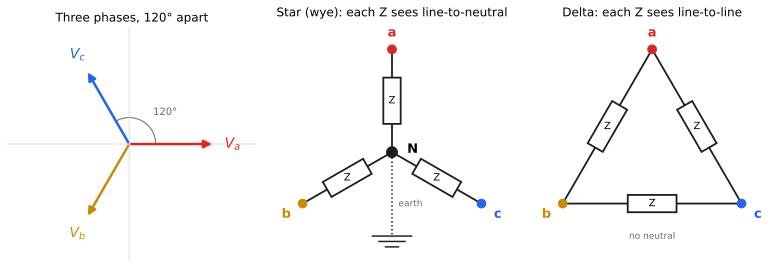

# Network modelling

How real network equipment and conventions map onto the power flow equations in [02_power_flow_equations.md](02_power_flow_equations.md). Both solvers use these models: [04_ac_power_flow.md](04_ac_power_flow.md) uses all of each model, and [05_dc_power_flow.md](05_dc_power_flow.md) uses part of it.

## 1. Balanced three-phase modelling
In the power flow equations we modelled a set of lines and buses fed by some sinusoidal voltage relative to ground. In reality, power systems are built aroud conventional generators that produce 3 phases 120deg apart.

Loads can be connected line to neutral or line to line.

Rather than model all 3 phases, we assume the system is **balanced**: the three phase voltages have the same size and are 120° apart, and each phase carries the same load. Then each phase carries the same power, and the three phase currents are also 120° apart. So the power flow equations describe one phase, and the total power is 3 times the power of that phase.

To cover:

- Three phases, 120° apart, and why they add to zero at every instant
- What "balanced" means, and why one phase is enough
- What neutral is (the star point), and why it stays at 0 V in a balanced system
- The "ground" in the power flow equations is the neutral, so every bus voltage $V_i$ is a line-to-neutral voltage
- Line-to-line and line-to-neutral voltages: how they relate in size and angle
- Why voltages are quoted line-to-line (three-wire networks have no neutral conductor)
- Star and delta connections: what voltage each element sees
- Converting a balanced delta to an equivalent star, so all equipment fits the power flow equations
- Transformer vector groups (for example Dyn11) and the 30° phase shift
- Three-phase power and one-phase power

## 2. Per-unit system

To cover:

- What per-unit means, and the two base values you choose
- How the other base values follow from those two
- Convert impedances, voltages and powers to per-unit and back
- What happens to the three-phase factors from section 1
- What happens to a transformer at its nominal ratio
- Why voltages near 1.0 make errors easy to see

## 3. Lines: the pi model

To cover:

- Which parts of a real line give R, X and capacitance
- How the pi model places each part between the two buses and ground
- Line data in ohms and farads per km, times the length
- When the capacitance matters (long lines, cables) and when it can be ignored
- What the pi model adds to Ybus

## 4. Shunts

To cover:

- A shunt is a branch from a bus to ground. What is the voltage at ground?
- So what does a shunt add to KCL, and to Ybus?
- Examples: capacitor banks, reactors, line capacitance

## 5. Transformers

To cover:

- The ideal transformer: voltage ratio and current ratio
- The series impedance, from the nameplate data
- Off-nominal tap ratio and phase shift
- The transformer as a pi model, and its Ybus entries
- What per-unit does to it

## 6. Conventions in the field

To cover:

- Quoted voltages: RMS and line-to-line (11 kV, 400 V, 230 V)
- Quoted power: the total of all three phases (MW, Mvar)
- Insulation ratings: in kV peak
- Load sign: data tables enter loads as positive consumption, but the equations use injections
