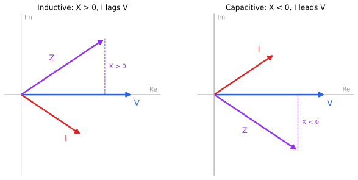

# Power flow equations

## 1. Voltage and current in an RLC circuit

The source voltage is a cosine with peak $V_m$ and angular frequency $\omega = 2\pi f$:

$$v(t) = V_m\cos(\omega t)$$

The elements are in series, so the same current $i(t)$ flows through all three.

**Kirchhoff's voltage law** around the loop:

$$v(t) = v_R + v_L + v_C$$

The voltage across each element:

$$v_R = R i(t)$$

$$v_L = L\frac{di}{dt}$$

$$\frac{dv_C}{dt} = \frac{i(t)}{C} \quad\Rightarrow\quad v_C = \frac{1}{C}\int i(t) dt$$

So putting that all together gives:

$$V_m\cos(\omega t) = R i(t) + L\frac{di}{dt} + \frac{1}{C}\int i(t) dt$$

This is one equation with one unknown function, $i(t)$. It is a differential equation, and its solution has two parts:

- **Transient part:** dies away after the circuit switches on. Power flow ignores it.
- **Steady-state part:** a cosine at the same frequency $\omega$, with a different peak $I_m$ and a phase shift $\varphi$:

$$i(t) = I_m\cos(\omega t + \varphi)$$

To find $I_m$ and $\varphi$, substitute this $i(t)$ into the equation, expand all the sin and cos terms, and match coefficients. This is messy and requires a lot of trigonometry, hence the complex representation.

Unlike a resistor alone, there is no fixed ratio between $v(t)$ and $i(t)$. The inductor and capacitor make the voltage depend on how fast the current changes, so $v(t)/i(t)$ varies through the cycle. In the complex representation, this ratio becomes a constant, $Z$.

## 2. Complex representation and phasors

We use a complex representation of $v(t)$ and $i(t)$ to make the maths a lot simpler. Euler's formula links a cosine to a complex exponential:

$$e^{j\theta} = \cos\theta + j\sin\theta$$

So each cosine is the real part of a complex number that rotates at $\omega$:

$$v(t) = \text{Re}\lbrace V_m\cos(\omega t) + jV_m\sin(\omega t) \rbrace = \text{Re}\lbrace V_m e^{j\omega t} \rbrace$$

$$i(t) = \text{Re}\lbrace I_m\cos(\omega t+\varphi) + jI_m\sin(\omega t+\varphi) \rbrace = \text{Re}\lbrace I_m e^{j(\omega t+\varphi)} \rbrace$$

**Why we can do this.** The circuit equation is linear and $R$, $L$, $C$ are real. Taking the real part gives the same result before or after a derivative, an integral or a multiplication by a real constant. So if the complex versions satisfy the equation, their real parts do too.

**Calculus becomes algebra.** The exponential is easy to differentiate and integrate:

$$\frac{d}{dt}e^{j(\omega t+\varphi)} = j\omega  e^{j(\omega t+\varphi)} \qquad \int e^{j(\omega t+\varphi)} dt = \frac{1}{j\omega}  e^{j(\omega t+\varphi)}$$

(The constant of integration would be a DC offset. Steady state has none, so we drop it.)

So going back to KVL, $v = v_R + v_L + v_C$:

$$V_m e^{j\omega t} = R I_m e^{j(\omega t+\varphi)} + j\omega L I_m e^{j(\omega t+\varphi)} + \frac{1}{j\omega C} I_m e^{j(\omega t+\varphi)}$$

Rearranging:

$$V_m e^{j\omega t} = I_m e^{j\varphi} e^{j\omega t}\left(R + j\omega L + \frac{1}{j\omega C}\right)$$

**Phasors.** The factor $e^{j\omega t}$ is on both sides, so it cancels. This is where the steady-state assumption pays off: every voltage and current is a sinusoid at the same $\omega$, so $e^{j\omega t}$ cancels from every equation. What remains is one complex number per quantity, which holds its magnitude and its phase angle. This is the **phasor**. With the source as the angle reference:

$$V = V_m \qquad I = I_m e^{j\varphi}$$

$$\boxed{V = Z I} \qquad Z = R + j\omega L + \frac{1}{j\omega C}$$

This is Ohm's law with complex numbers. The time has gone, and the differential equation is now one line of algebra.

To get back to the time domain, multiply by $e^{j\omega t}$ and take the real part: $i(t) = \text{Re}\lbrace I e^{j\omega t} \rbrace$.

## 3. Impedance and the phase shift

What this means physically: $\lvert Z \rvert$ sets the size of the current, and the reactive parts $j\omega L$ and $\frac{1}{j\omega C}$ set the phase shift $\varphi$. This section shows the maths.

Tidy $Z$ first. Since $j \cdot (-j) = 1$, we have $\frac{1}{j} = -j$. So:

$$Z = R + j\left(\omega L - \frac{1}{\omega C}\right) = R + jX$$

| Symbol | Name | Value |
| --- | --- | --- |
| $R$ | resistance | real part of $Z$ |
| $X_L$ | inductive reactance | $\omega L$ |
| $X_C$ | capacitive reactance | $\frac{1}{\omega C}$ |
| $X$ | reactance | $X_L - X_C$, the imaginary part of $Z$ |

**Polar form.** Write $Z$ as a magnitude and an angle (see the appendix):

$$Z = |Z| e^{j\theta_Z} \qquad |Z| = \sqrt{R^2 + X^2} \qquad \theta_Z = \text{atan2}(X, R)$$

**The phase shift.** To divide complex numbers in polar form, divide the magnitudes and subtract the angles:

$$I = \frac{V}{Z} = \frac{V_m e^{j0}}{|Z| e^{j\theta_Z}} = \frac{V_m}{|Z|} e^{-j\theta_Z}$$

Compare this with $I = I_m e^{j\varphi}$:

$$\boxed{I_m = \frac{V_m}{|Z|} \qquad \varphi = -\theta_Z}$$

| Case | $X$ | $\theta_Z$ | Current |
| --- | --- | --- | --- |
| Inductive | $X > 0$ | $0^\circ$ to $90^\circ$ | lags the voltage |
| Capacitive | $X < 0$ | $-90^\circ$ to $0^\circ$ | leads the voltage |
| Resonance | $X = 0$ | $0^\circ$ | in phase, and at its maximum $V_m/R$ |

**Picture to remember.** Draw $V$ flat along the real axis. Draw $Z = R + jX$ as an arrow from the origin. $R$ is always positive, so $Z$ always points right. $X$ decides whether it points up or down.

Since $I = V/Z$, the angle of $I$ is minus the angle of $Z$. So $I$ is the **mirror image of $Z$ in the real axis**:

- Inductor: $X > 0$, so $Z$ points up and $I$ points down. $I$ is behind $V$ (clockwise), so $I$ **lags**.
- Capacitor: $X < 0$, so $Z$ points down and $I$ points up. $I$ is ahead of $V$ (anticlockwise), so $I$ **leads**.

Phasors turn anticlockwise, so "ahead" means anticlockwise. The arrow lengths are not to scale, because $V$, $Z$ and $I$ have different units.

Mnemonic: **ELI the ICE man**. In an inductor (L), the voltage (E) comes before the current (I). In a capacitor (C), the current (I) comes before the voltage (E).

Resonance occurs when $X_L = X_C$, at $\omega_0 = 1/\sqrt{LC}$.

**Example.** Take $R = 10$ Ω and $X = 10$ Ω. Then:

$$|Z| = \sqrt{10^2 + 10^2} = 14.1 \ \Omega \qquad \theta_Z = \text{atan2}(10, 10) = 45^\circ$$

So $I_m = V_m / 14.1$ and the current lags the voltage by 45°. At 50 Hz one cycle takes 20 ms, so the time shift is:

$$\frac{45}{360} \times 20 \text{ ms} = 2.5 \text{ ms}$$

Try it: [demos/rlc_series.html](../demos/rlc_series.html).

## 4. Admittance (Y, G, B)

So we got to $I = V / Z$, where:

$$Z = R + j\omega L + \frac{1}{j\omega C} = R + jX \qquad X = \omega L - \frac{1}{\omega C}$$

| Symbol | Name | Meaning |
| --- | --- | --- |
| $Z$ | impedance | The ratio $V/I$. Its size scales the current and its angle sets the phase shift. |
| $R$ | resistance | The part that turns energy into heat. |
| $X$ | reactance | The part from energy stored in the inductor (magnetic field) and the capacitor (electric field). The element stores energy in one quarter cycle and gives it back in the next, so on average it uses no energy. |

**Why define admittance?** $I = V/Z$ is already linear. We define $Y = 1/Z$, so $I = YV$, for two practical reasons:

1. **Parallel elements add.** Impedances in series add: $Z = Z_1 + Z_2$. Admittances in parallel add: $Y = Y_1 + Y_2$. At a bus, many elements connect in parallel, and KCL adds up their currents. So admittance gives the bus equations directly. This is why the Ybus matrix (section 7) uses admittances.
2. **No division, and no infinity.** $I = YV$ is a multiplication. An open circuit is $Y = 0$, not $Z = \infty$.

**Splitting Y into G and B.** Multiply the top and bottom by the conjugate $R - jX$, so the bottom becomes real:

$$Y = \frac{1}{R + jX} = \frac{R - jX}{(R + jX)(R - jX)} = \frac{R - jX}{R^2 + X^2}$$

The bottom has no $j$ because $(R + jX)(R - jX) = R^2 - j^2X^2 = R^2 + X^2$.

$$Y = \frac{R}{R^2 + X^2} - j\frac{X}{R^2 + X^2} = G + jB$$

$$G = \frac{R}{R^2 + X^2} \qquad B = \frac{-X}{R^2 + X^2}$$

| Symbol | Name | Meaning |
| --- | --- | --- |
| $Y$ | admittance | $1/Z$, in siemens (S) |
| $G$ | conductance | the real part of $Y$ |
| $B$ | susceptance | the imaginary part of $Y$ |

Two traps:

- $G \neq 1/R$ unless $X = 0$. The reactance changes the conductance too.
- $B$ has the **opposite sign** to $X$. An inductive element has $X > 0$ and $B < 0$. A capacitive element has $X < 0$ and $B > 0$.

**Single elements:**

| Element | $Z$ | $Y$ |
| --- | --- | --- |
| Resistor | $R$ | $\frac{1}{R}$ |
| Inductor | $j\omega L$ | $\frac{-j}{\omega L}$ |
| Capacitor | $\frac{-j}{\omega C}$ | $j\omega C$ |

The capacitor admittance $j\omega C$ explains the "huge C" result from the demo. In series, a large C has a small impedance, so it acts like a wire. In parallel to ground (a shunt), a large C has a large admittance, so it draws more current. Power lines have their capacitance in shunt. In the line model, each end gets a shunt $jB/2$ with $B = \omega C$.

## 5. Instantaneous power, P and Q

In real circuits we often think about energy and power, because this is what power plants produce and consumers use.

### Instantaneous power

From the definitions, the power at any instant is voltage times current:

$$p(t) = v(t) i(t) = V_m\cos(\omega t) \cdot I_m\cos(\omega t + \varphi)$$

### Product to sum

Add the two angle-addition formulas:

$$\cos(A - B) = \cos A\cos B + \sin A\sin B$$

$$\cos(A + B) = \cos A\cos B - \sin A\sin B$$

The sin terms cancel, which gives:

$$\cos A\cos B = \tfrac{1}{2}\left[\cos(A - B) + \cos(A + B)\right]$$

Use $A = \omega t$ and $B = \omega t + \varphi$. Then $A - B = -\varphi$ and $A + B = 2\omega t + \varphi$. Also $\cos(-\varphi) = \cos\varphi$. So:

$$p(t) = \frac{V_m I_m}{2}\left[\cos\varphi + \cos(2\omega t + \varphi)\right]$$

### Split into P and Q

Expand the second term with the angle-addition formula:

$$\cos(2\omega t + \varphi) = \cos 2\omega t\cos\varphi - \sin 2\omega t\sin\varphi$$

Substitute it, and group the $\cos\varphi$ terms and the $\sin\varphi$ terms:

$$p(t) = \frac{V_m I_m}{2}\cos\varphi \left(1 + \cos 2\omega t\right) - \frac{V_m I_m}{2}\sin\varphi \sin 2\omega t$$

Define:

$$P = \frac{V_m I_m}{2}\cos\varphi \qquad Q = -\frac{V_m I_m}{2}\sin\varphi$$

$$\boxed{p(t) = P\left(1 + \cos 2\omega t\right) + Q\sin 2\omega t}$$

**>> The key thing here is that P and Q are not the time varying power and reactive power, they are the coefficients that scale the sinusoids.**

### What the two parts mean

Both parts oscillate at $2\omega$, because $v$ and $i$ both change sign every half cycle.

| Part | Shape | Average | Meaning |
| --- | --- | --- | --- |
| $P(1 + \cos 2\omega t)$ | pulses between 0 and $2P$, never negative | $P$ | Energy flows one way, into the load. It does work or makes heat. |
| $Q\sin 2\omega t$ | swings between $+Q$ and $-Q$ | 0 | Energy goes into the L or C for a quarter cycle and comes back in the next. No net work. |

One way to see this: split the current into a part in step with $v$ and a part a quarter cycle out of step:

$$i(t) = I_m\cos\varphi\cos\omega t - I_m\sin\varphi\sin\omega t$$

- The in-step part behaves like a resistor. It gives the $P$ term.
- The out-of-step part behaves like a pure inductor or capacitor. It gives the $Q$ term.

The two extreme cases:

| Case | $\varphi$ | $P$ | $Q$ | $p(t)$ |
| --- | --- | --- | --- | --- |
| Pure resistor | $0^\circ$ | $\frac{V_m I_m}{2}$ | 0 | always positive |
| Pure inductor | $-90^\circ$ | 0 | $+\frac{V_m I_m}{2}$ | positive half the time, negative half the time |
| Pure capacitor | $+90^\circ$ | 0 | $-\frac{V_m I_m}{2}$ | the same, but in the opposite order |

Sign convention: an inductor absorbs reactive power ($Q > 0$) and a capacitor supplies it ($Q < 0$).

Try it: [demos/power.html](../demos/power.html).

## 6. Complex power (S = VI*)

We've established that working with $V$ and $I$ as phasors simplifies the maths a lot. In real circuits we want to specify $P$ and $Q$, not $I$, because this is easier to work with. So we need a way to get $P$ and $Q$ from the phasors $V$ and $I$.

Use the phasors from section 2: $V = V_m$ and $I = I_m e^{j\varphi}$. Multiply $V$ by the conjugate of $I$:

$$VI^{\ast} = V_m \cdot I_m e^{-j\varphi} = V_m I_m e^{-j\varphi}$$

The result has no time in it. Even with the rotating forms $V_m e^{j\omega t}$ and $I_m e^{j(\omega t + \varphi)}$, the conjugate makes the $e^{j\omega t}$ terms cancel. This is why we use the conjugate: $VI$ would keep a $2\omega t$ term.

Expand with Euler's formula:

$$VI^{\ast} = V_m I_m\cos\varphi - jV_m I_m\sin\varphi$$

Compare with $P$ and $Q$ from section 5:

$$P = \frac{V_m I_m}{2}\cos\varphi \qquad Q = -\frac{V_m I_m}{2}\sin\varphi$$

So half of $VI^{\ast}$ gives both at once:

$$\boxed{S = \tfrac{1}{2}VI^{\ast} = P + jQ}$$

$S$ does not define $P$ and $Q$. They have their physical meaning from $p(t)$: $P$ is the average power and $Q$ is the size of the back-and-forth part. $S$ is a short way to calculate both from the phasors, without going back to the time domain.

The $\frac{1}{2}$ is a nuisance. Section 7 removes it.

## 7. RMS values
The 1/2 in the definition of S is considered a nuisance for engineers.

If we define V = V_rms = V_m / sqrt(2) 

We get v(t) = sqrt(2) Re{V exp(jwt)}
We also define I = I_rms = I_m / sqrt(2)

## 8. Kirchhoff's current law at each bus

## 9. Building the Ybus matrix

## 10. Complex power at each bus in terms of Y and V

## 11. Separate equations for P and Q

## 12. Bus types and the count of equations and unknowns

## 13. Newton-Raphson on the unknown subset

## 14. Fill in the remaining values

## 15. Per-unit system

## Appendix: complex number toolkit

| Fact | Formula |
| --- | --- |
| Definition | $j^2 = -1$, so $\frac{1}{j} = -j$ |
| Rectangular form | $z = a + jb$ |
| Polar form | $z = r e^{j\theta} = r(\cos\theta + j\sin\theta)$ |
| Rectangular to polar | $r = \sqrt{a^2 + b^2}$, $\theta = \text{atan2}(b, a)$ |
| Polar to rectangular | $a = r\cos\theta$, $b = r\sin\theta$ |
| Multiply | multiply the magnitudes, add the angles |
| Divide | divide the magnitudes, subtract the angles |
| Multiply by $j$ | $j = e^{j\pi/2}$, so it turns a phasor $90^\circ$ forward |
| Conjugate | $z^{\ast} = a - jb = r e^{-j\theta}$, and $z z^{\ast} = r^2$ |

Use `atan2(b, a)`, not `atan(b/a)`. `atan` loses the quadrant when $a < 0$. In numpy: `np.abs(z)`, `np.angle(z)`, `np.conj(z)`.

Multiply by $j$ explains the inductor: $V_L = j\omega L I$, so the inductor voltage is $90^\circ$ ahead of the current. The capacitor has $-j$, so its voltage is $90^\circ$ behind.
